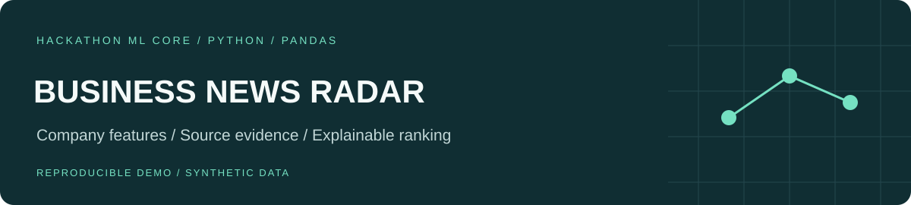
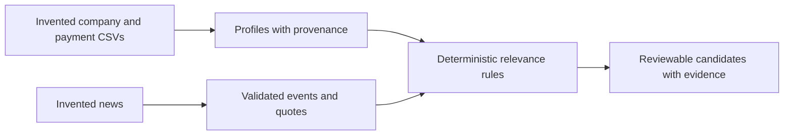

# Business News Radar

**An offline ML/Data portfolio edition of a team project for the Alfa Future hackathon, Alfa-Bank case.** It demonstrates how company data and news evidence can produce explainable relevance candidates for human review.

The full team application combines Go services, a React interface and an agent workflow. This edition contains the original company-profiling, event-contract and deterministic matching components with a new synthetic demonstration. It does not reproduce the internet-bank interface or claim the work of the entire team as one person's contribution.

## Problem and approach

A headline matters differently to a borrower, an employer and a company without the corresponding exposure. The pipeline keeps the connection visible: which source phrase was recognized, which company feature matched, and how much each rule contributed.



## Reproduce the example

Use Python 3.12 in a virtual environment:

```bash
python -m pip install -r requirements.txt
python demo.py
python demo.py --output demo-output
python -m pytest
```

The demonstration generates all inputs locally and uses no credentials, network calls or paid models. Output must be a new directory; existing paths are refused. It produces JSON with profiles, event annotations and candidates, plus a short Markdown report.

| Invented company | Profile distinction | Selected event |
|---|---|---|
| U_9000001 | Loan product present | Key-rate event |
| U_9000002 | Payroll product present | Labour-market event |
| U_9000003 | Neither product present | No supported match |

The third outcome is intentional: the system should not invent exposure when the required feature is absent.

## What the code demonstrates

- **Company profiling:** typed input checks, graph aggregation, separation of self/intragroup/external/unknown payments, concentration metrics and explicit data gaps. Every raw feature retains file, row, column and hash provenance.
- **Evidence contracts:** strict event schemas, exact source-quote checks, numeric/date validation, and separate forecast, opinion and abstention statuses.
- **Explainable ranking:** deterministic feature contributions, source links, cluster deduplication and stable ordering. Candidates retain `review_required` status.
- **Reproducibility:** generated fixtures, dependency pins, tests and Linux/Windows CI configuration.

## Scope and limitations

This edition uses the inherited **keyword event baseline and baseline matching rules**. It includes no live LLM adapter, learned ranker, bank research excerpts, organizer company profiles, saved news articles or historical evaluation outputs. Relevance points are not probabilities, financial-impact estimates or measured business uplift. A supported quote does not prove the semantic correctness of an interpretation. Payment links alone do not establish supplier relationships, ownership or market share.

The synthetic example verifies behavior and invariants, not performance on unseen companies or news. No hackathon placement, production deployment or independently reviewed model-quality score is claimed. The source code and generated analytical details retain Russian terminology; this guide is in English.

## Code map

- `ml/company_profiles_v1/`: original profile engine, contracts, integration mapping and rendering.
- `ml/news_events_v1/`: original event contracts, keyword baseline and evidence checks.
- `ml/company_event_matching_v1/matching.py`: original baseline matcher; the separate experimental matcher is excluded.
- `demo.py`: newly generated company/payment fixtures and end-to-end assertions.
- `tests/`: synthetic personalization, provenance and export regression checks; original synthetic profile/event tests are retained beside their modules.

See [provenance and attribution](PROVENANCE.md) for the boundary between the team project and this portfolio edition.
